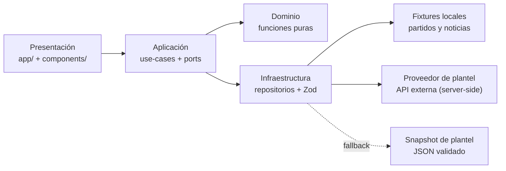
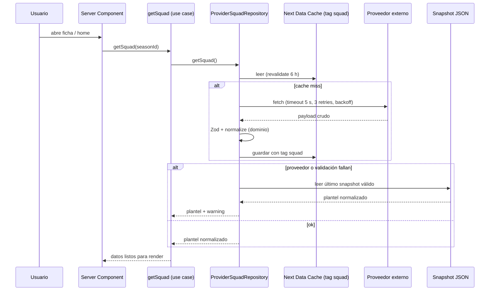

# Plan técnico — Mundo River (v1)

> Este documento traduce `spec.md` en decisiones de arquitectura, stack, estructura y estrategia de pruebas.
> No contiene código de interfaz: define **cómo** se construirá.

---

## 1. Objetivos técnicos

| ID | Objetivo | Cómo se garantiza |
|----|----------|-------------------|
| OT-01 | Lógica de negocio testeable y aislada | `src/domain` puro + test de arquitectura + cobertura ≥ 95 % |
| OT-02 | Cero desfasaje horario | Instantes UTC en el modelo; `Intl` con `timeZone` explícito; componente `LocalDate`; matriz de tests |
| OT-03 | Render rápido y SEO | Server Components por defecto; islas cliente mínimas; ISR para contenido |
| OT-04 | Datos intercambiables | Patrón Repository + contratos Zod; adaptadores mock, proveedor de plantel y futura API de partidos |
| OT-05 | Escalable por specs | Módulos por dominio, features independientes, documentación trazable |
| OT-06 | Identidad oficial y accesible | Escudo oficial optimizado, reglas de uso, fallback monocromático y auditoría de contraste |
| OT-07 | Plantel confiable y resiliente | Adaptador server-side + normalización pura + caché con tag + snapshot de respaldo |

---

## 2. Stack

| Capa | Elección | Justificación |
|------|----------|---------------|
| Framework | **Next.js 15 (App Router)** | RSC, streaming, ISR, SEO y rutas dinámicas sin servidor propio |
| Lenguaje | **TypeScript 5.x (strict)** | Contratos explícitos y refactors seguros |
| Estilos | **Tailwind CSS v4** | Tokens rápidos, dark mode, sin CSS muerto |
| Componentes | **shadcn/ui + Radix Primitives** | Accesibilidad probada y control total del markup |
| Iconografía | **Lucide React** | Consistente y tree-shakeable |
| Validación | **Zod** | Contratos de datos en runtime + tipos inferidos |
| Fechas | **Intl nativo + utilidades propias** | Cero dependencias, control total de `timeZone`; se evita `date-fns-tz` |
| Datos cliente (live) | **TanStack Query** | Polling, caché, reintentos y `refetchOnWindowFocus` |
| Plantel | **Proveedor externo vía adaptador server-side + caché `squad`** | Datos actualizados sin deploy; el cliente nunca ve la API key |
| Respaldo de plantel | **Snapshot JSON validado** | Operación continua ante caída o rate limit del proveedor |
| Marca | **Escudo oficial SVG/PNG provisto por el club** | Identidad correcta y escalable, con fallback propio |
| Testing unitario | **Vitest + Testing Library** | Rápido, ESM nativo, compatible con RSC |
| Testing E2E | **Playwright** | Multi-browser, clock API para estados deterministas |
| Mocking | **Fixtures JSON + Zod + proveedor grabado** | Sin llamadas reales en CI |
| Calidad | **ESLint + Prettier + `tsc --noEmit`** | Estándar del ecosistema |
| CI/CD | **GitHub Actions + Vercel** | Pipeline reproducible y previews por PR |
| Gestor | **pnpm** | Instalación rápida y lockfile determinista |

---

## 3. Arquitectura por capas



**Regla de oro:** las dependencias apuntan hacia el dominio. `domain` no conoce a nadie.

| Capa | Responsabilidad | Puede importar |
|------|-----------------|----------------|
| `domain` | Reglas puras: fechas, estados, rankings, registros, normalización de plantel | Solo TypeScript y otras funciones de `domain` |
| `application` | Casos de uso, interfaces de repositorio (`ports`), DTOs | `domain` |
| `infrastructure` | Implementaciones de repos, esquemas Zod, fixtures, adaptadores de proveedor | `domain`, `application` |
| `app` / `components` | Render, interacción, estado de UI | `application`, `domain` (tipos), `components/ui` |
| `lib` | Utilidades transversales sin reglas de negocio | Librerías externas |

### 3.1 Verificación automática de la regla

1. `eslint-plugin-boundaries` bloquea imports invertidos.
2. Test `tests/unit/architecture/no-forbidden-date-apis.test.ts`: recorre `src/` con `fast-glob` y falla si encuentra `toISOString().slice(0,10)`, `getDate()`, `getMonth()`, `getDay()` o `toLocaleDateString()` sin `timeZone`, excepto en `src/domain/time/**`.
3. Test `tests/unit/architecture/domain-is-pure.test.ts`: verifica que ningún archivo de `src/domain` importe `react`, `next/*`, `node:*`, `fs` ni `fetch`.
4. Test `tests/unit/architecture/no-provider-secrets.test.ts`: verifica que `SQUAD_PROVIDER_KEY` no aparezca en archivos con `'use client'`, en `components/**` ni en `app/**` salvo route handlers server-side.

---

## 4. Estructura de carpetas

```text
.
├─ specs/
│  └─ 001-river-app/
│     ├─ spec.md
│     ├─ plan.md
│     └─ tasks.md
├─ src/
│  ├─ app/
│  │  ├─ layout.tsx
│  │  ├─ page.tsx                    # Home
│  │  ├─ globals.css
│  │  ├─ not-found.tsx
│  │  ├─ error.tsx
│  │  ├─ novedades/
│  │  │  ├─ page.tsx
│  │  │  └─ [slug]/page.tsx
│  │  ├─ calendario/page.tsx
│  │  ├─ partidos/[matchId]/page.tsx
│  │  ├─ temporada/page.tsx
│  │  └─ api/
│  │     └─ cron/sync-squad/route.ts # revalidateTag('squad') autenticado
│  ├─ components/
│  │  ├─ ui/                         # shadcn (button, tabs, badge, dialog…)
│  │  ├─ brand/                      # ClubCrest, BrandLockup
│  │  ├─ layout/                     # Header, Nav, Footer, Container
│  │  ├─ common/                     # LocalDate, EmptyState, ErrorState, Skeleton
│  │  ├─ news/                       # NewsCard, NewsFilters, NewsFeed
│  │  ├─ calendar/                   # MonthGrid, AgendaList, CompetitionFilter
│  │  ├─ match/                      # MatchHeader, Scoreboard, EventTimeline, StatsBars,
│  │  │                              # LineupPitch, RatingsTable, LiveIndicator
│  │  └─ season/                     # TopScorerCard, TopAssisterCard, SeasonRecordGrid
│  ├─ domain/
│  │  ├─ time/                       # toLocalDateKey, formatLocal*, groupByLocalDate
│  │  ├─ matches/                    # status, filters, sort, minute, headToHead
│  │  ├─ stats/                      # scorers, assists, record, form, ratings, mvp
│  │  ├─ news/                       # readingTime, filter, sort, paginate
│  │  ├─ squad/                      # normalize, validate, resolve
│  │  ├─ season/                     # summary aggregation
│  │  └─ types.ts                    # entidades del dominio
│  ├─ application/
│  │  ├─ ports/                      # NewsRepository, MatchRepository, SquadRepository
│  │  └─ use-cases/                  # getNewsFeed, getMatchCenter, getSeasonSummary, getSquad
│  ├─ infrastructure/
│  │  ├─ schemas/                    # Zod: match, news, season, player, squad
│  │  ├─ mock/                       # fixtures *.json + escenarios de demo
│  │  ├─ providers/                  # squad-provider.port.ts, api-football.adapter.ts (referencia)
│  │  ├─ snapshots/                  # squad.snapshot.json (respaldo validado)
│  │  └─ repositories/               # mock-news, mock-match, provider-squad
│  └─ lib/
│     ├─ env.ts
│     ├─ constants.ts
│     ├─ format.ts                   # helpers de presentación (usan domain/time)
│     └─ cn.ts
├─ tests/
│  ├─ unit/                          # domain + architecture
│  ├─ components/                    # Testing Library
│  ├─ e2e/                           # Playwright
│  ├─ providers/                     # payloads grabados (fixtures de proveedor)
│  └─ fixtures/                      # builders tipados
├─ public/
│  └─ brand/
│     ├─ escudo-river.svg            # asset oficial provisto por el club
│     ├─ escudo-river.png            # fallback raster @2x
│     └─ escudo-river-mono.svg       # variante monocromática de respaldo
├─ scripts/
│  └─ generate-squad-snapshot.ts     # crea/actualiza el snapshot desde el proveedor
├─ vitest.config.ts
├─ playwright.config.ts
├─ next.config.ts
├─ tailwind.config.ts
└─ package.json
```

---

## 5. Contratos de datos (Zod)

- Un esquema por entidad en `src/infrastructure/schemas/`.
- Los fixtures se validan **en tiempo de carga** (`parse`), no en cada render.
- Tipos de dominio derivados con `z.infer` y reexportados desde `src/domain/types.ts`.
- Regla de evolución: todo cambio de contrato exige actualizar el esquema, el fixture y un test de contrato.
- `publishedAt`, `kickoffAt`, `finishedAt` se declaran como `z.string().datetime({ offset: true })` y se normalizan a UTC al hidratar.

### 5.1 Contrato del proveedor de plantel

Dos niveles para aislar el formato del proveedor:

```ts
// Nivel 1 — adaptador específico del proveedor (infraestructura)
type ProviderPlayerDTO = {
  externalId: string;
  name: string;
  shirtNumber?: number | null;
  positionCode?: string | null;   // "GK" | "DEF" | "MID" | "FWD" | equivalente del proveedor
  nationality?: string | null;
  photoUrl?: string | null;
  contractUntil?: string | null;  // AAAA-MM-DD
  updatedAt: string;              // ISO-8601
};

type RawSquadPayload = {
  provider: string;
  fetchedAt: string;              // ISO-8601
  players: ProviderPlayerDTO[];
};

// Nivel 2 — contrato interno normalizado (dominio)
type NormalizedSquad = {
  provider: string;
  fetchedAt: string;
  players: Player[];              // id canónico `${provider}:${externalId}`
  memberships: SquadMembership[];
  warnings: SquadWarning[];
};
```

```ts
export const ProviderPlayerDTOSchema = z.object({
  externalId: z.string().min(1),
  name: z.string().min(1),
  shirtNumber: z.number().int().min(1).max(99).nullable().optional(),
  positionCode: z.string().nullable().optional(),
  nationality: z.string().nullable().optional(),
  photoUrl: z.string().url().nullable().optional(),
  contractUntil: z.string().regex(/^\d{4}-\d{2}-\d{2}$/).nullable().optional(),
  updatedAt: z.string().datetime({ offset: true }),
});
```

**Decisión:** el adaptador del proveedor solo **extrae y renombra** campos; la normalización, validación semántica y orden viven en `domain/squad` y son 100 % testeables sin red.

---

## 6. Estrategia de fechas y zona horaria (crítica)

### 6.1 Almacenamiento

- Todo instante viaja como **ISO-8601 UTC** (`...Z`). Nunca se guarda una fecha «pelada».
- Ninguna capa intermedia aplica offsets manuales.

### 6.2 Render

1. El servidor lee la cookie `mr_tz` (escrita por el cliente al primer render). Si no existe, usa `America/Argentina/Buenos_Aires`.
2. El componente `<LocalDate instant={iso} variant="datetime" />` es **cliente**:
   - `useState(serverTimeZone)` → el primer render de hidratación coincide con el HTML del servidor.
   - `useEffect` detecta `Intl.DateTimeFormat().resolvedOptions().timeZone`, actualiza el estado y persiste la cookie.
   - Tras el cambio, el texto se formatea de nuevo sin error de hidratación.
3. El nodo `<time dateTime={iso} data-tz={tz}>` mantiene semántica y permite estilos estables.

```
SSR  → "sáb 14 mar · 22:30"   (tz cookie o AR)
Client (hidratación) → mismo texto
Effect → detecta tz real → re-render si difiere
```

### 6.3 Reglas de implementación

- `toLocalDateKey(instant, tz)` usa `Intl.DateTimeFormat('en-CA', { timeZone, year, month, day })` y arma `AAAA-MM-DD`.
- Los encabezados «Hoy/Mañana» comparan claves locales, nunca diferencias de 24 h.
- Los filtros por mes usan `AAAA-MM` local.
- Tests obligatorios con `America/Argentina/Buenos_Aires`, `Europe/Madrid`, `America/New_York` y `Asia/Tokyo`.
- El test de arquitectura (§3.1) impide reintroducir el patrón UTC.

### 6.4 Escenario de demo determinista

- `NEXT_PUBLIC_MOCK_NOW` (opcional) fija el «ahora» del adaptador mock.
- `?demo=live|halftime|finished` permite forzar un escenario en desarrollo y E2E.
- En producción con API real, el `now` proviene del servidor/cliente y el estado se deriva igual.

---

## 7. Datos, repositorios e integraciones

```ts
// application/ports
export interface MatchRepository {
  getSeasonMatches(seasonId: string): Promise<Match[]>;
  getMatchById(matchId: string): Promise<Match | null>;
  getSeasonSummary(seasonId: string): Promise<SeasonSummary>;
}

export interface SquadRepository {
  getSquad(seasonId: string): Promise<NormalizedSquad>;
  getPlayer(playerId: string): Promise<Player | null>;
}
```

- `MockMatchRepository` lee fixtures validados y aplica el escenario de demo.
- `MockNewsRepository` pagina y filtra en memoria.
- `ProviderSquadRepository` implementa `SquadRepository` con caché + snapshot.
- Un futuro `ApiMatchRepository` implementará la misma interfaz; **ningún cambio en dominio ni UI**.

### 7.1 Integración con el proveedor de plantel



**Reglas de implementación**

| Aspecto | Decisión |
|---------|----------|
| Ejecución | Solo servidor (`server-only`), dentro de Server Components o route handlers |
| Caché | `unstable_cache` / `fetch` con `next: { revalidate: 21600, tags: ['squad'] }` |
| Invalidación | `/api/cron/sync-squad` protegido con `CRON_SECRET` → `revalidateTag('squad')`; Vercel Cron cada 6 h |
| Timeout / retry | 5 s por intento, 3 intentos, backoff 300/900/2700 ms + jitter |
| Rate limit | Single-flight con un `Map<string, Promise>` en módulo; nunca N llamadas concurrentes |
| Snapshot | `src/infrastructure/snapshots/squad.snapshot.json`, validado con el mismo esquema; se actualiza con `pnpm squad:snapshot` |
| IDs | `Player.id = "${provider}:${externalId}"`; nunca se usa el nombre como clave |
| Fotos | Se permiten URLs del proveedor con `next/image` + `remotePatterns`; si falla, placeholder local |
| Secretos | `SQUAD_PROVIDER`, `SQUAD_PROVIDER_URL`, `SQUAD_PROVIDER_KEY`, `SQUAD_REVALIDATE_SECONDS` (server-only) |
| Tests | Payloads grabados en `tests/providers/`; CI sin red y sin key real |

**Proveedor concreto:** pendiente de elección (A-11). El diseño no depende de él: se implementa `ProviderSquadRepository` contra `RawSquadPayload` y un adaptador de referencia (`api-football.adapter.ts`) que documenta el mapeo de campos. Cambiar de proveedor = nuevo adaptador, sin tocar dominio ni UI.

---

## 8. Fetching, estado y caché

| Necesidad | Estrategia |
|-----------|------------|
| Contenido (noticias, temporada, fixtures) | Server Components + datos en build/ISR (`revalidate = 60`, tags por categoría) |
| Ficha de partido finalizado | RSC con `revalidate = 300` |
| Partido en vivo | Shell RSC + isla cliente con TanStack Query (`refetchInterval: 30_000`, `refetchIntervalInBackground: false`, `refetchOnWindowFocus: true`) |
| Plantel | `ProviderSquadRepository` + tag `squad` (6 h) + snapshot de respaldo |
| Filtros | Estado en URL (`useSearchParams` + `router.replace`), no estado global |
| Preferencias | Cookie `mr_tz` y `mr_theme`; sin store global |
| Errores de datos | `error.tsx` por segmento + `ErrorBoundary` en islas |

**Decisión:** no se usa Redux/Zustand. La URL es la fuente de verdad de los filtros y React Query cubre solo lo volátil.

---

## 9. Rutas y renderizado

| Ruta | Render | Contenido |
|------|--------|-----------|
| `/` | RSC + islas | Próximo partido (o último resultado), últimas 4 novedades, accesos a goleador/asistente, CTA al calendario |
| `/novedades` | RSC (searchParams) | Feed + filtros + paginación |
| `/novedades/[slug]` | SSG/ISR | Artículo, relacionados, JSON-LD `NewsArticle` |
| `/calendario` | RSC + isla de filtros | Vista mes/agenda, filtros, estados |
| `/partidos/[matchId]` | RSC + isla live | Ficha según estado, pestañas, JSON-LD `SportsEvent` |
| `/temporada` | RSC | Rankings, registro, racha, splits |
| `/api/cron/sync-squad` | Route Handler | Invalida tag `squad` (autenticado, no indexable) |
| `not-found` / `error` | — | 404 y recuperación |

`generateMetadata` por ruta; `generateStaticParams` para artículos y partidos finalizados.

---

## 10. UI y sistema de diseño

- **Identidad:** blanco, rojo y negro; acento rojo `#E30613`, superficies neutras, modo claro por defecto y oscuro opcional.
- **Tipografía:** una familia variable para UI + una condensada para marcadores (con `font-display: swap`).
- **Breakpoints:** `sm 640`, `md 768`, `lg 1024`, `xl 1280`; diseño base 360 px.
- **Componentes clave:** `ClubCrest`, `Scoreboard`, `MatchStatusBadge`, `StatsBars`, `RatingsTable`, `MonthGrid`, `NewsCard`, `FilterChips`, `LocalDate`, `EmptyState`, `Skeletons`.
- **Accesibilidad:** Radix para tabs/dialog; `aria-live` solo en regiones de eventos; foco visible; sin dependencia exclusiva del color.
- **Movimiento:** transiciones ≤ 200 ms, desactivadas con `prefers-reduced-motion`.

### 10.1 Reglas del escudo oficial

| Regla | Implementación |
|-------|----------------|
| Fidelidad | Se usa el asset provisto por el club, sin recolorear, recortar ni deformar |
| Aspecto | `width`/`height` con `aspect-ratio`; `object-fit: contain`; prohibido `object-fit: cover` |
| Tamaños | 24, 40, 64 y 96 px; mínimo 24 px; área de resguardo = 25 % del alto |
| Formatos | SVG principal; PNG @2x como respaldo; peso ≤ 30 KB (SVG) / ≤ 60 KB (PNG) |
| Accesibilidad | `alt="Escudo de River Plate"`; decorativo en contextos ya nombrados → `alt=""` |
| Fallback | `onError` → `escudo-river-mono.svg` con el mismo `box-sizing` y dimensiones |
| Fondos | Variante para fondo claro y oscuro si el club la provee; nunca invertir colores por CSS |
| CLS | Contenedor con dimensiones reservadas; `priority` solo en el header y el hero |

---

## 11. Estrategia de testing

### 11.1 Pirámide

| Nivel | Herramienta | Alcance | Meta |
|-------|-------------|---------|------|
| Unitario | Vitest (node) | `src/domain/**` y casos de uso | ≥ 95 % ramas |
| Componentes | Vitest + Testing Library (jsdom) | Filtros, tabs, tablas, estados vacíos, `ClubCrest` | Flujos críticos |
| Arquitectura | Vitest + fast-glob | Reglas de dependencia, fechas prohibidas y secretos | 3 tests |
| Contrato | Vitest + Zod | Fixtures locales + payloads de proveedor grabados | 100 % |
| Integración | Vitest + `fetch` mockeado | Proveedor: éxito, timeout, 429, 500, JSON inválido → snapshot | 6 escenarios |
| E2E | Playwright | 4 flujos críticos, 2 viewports | 100 % en CI |

### 11.2 E2E obligatorios

1. **Novedades:** filtrar por Inferiores → URL actualizada → abrir artículo → relacionados.
2. **Calendario:** cambiar a vista Agenda → filtrar por competición → abrir partido.
3. **Match Center en vivo:** con reloj fijo, verificar badge, marcador, minuto y actualización tras `refetch`.
4. **Post-partido:** abrir pestaña Calificaciones → verificar MVP, nota «SC» y promedio.
5. **Plantel degradado:** con el adaptador forzado a error, verificar que la ficha sigue funcionando con el snapshot y muestra el aviso.

### 11.3 Determinismo

- `page.clock.install({ time: new Date('2026-03-14T22:30:00-03:00') })` en Playwright.
- Builders de fixtures (`buildMatch`, `buildEvent`, `buildPlayer`, `buildSquadPayload`) con defaults y overrides.
- Los tests de dominio reciben `timeZone` y `now` explícitos: no dependen del reloj ni del entorno.
- El adaptador de proveedor se sustituye por un fake con payloads grabados; **cero llamadas de red en CI**.

---

## 12. Presupuesto de performance

| Métrica | Presupuesto | Verificación |
|---------|-------------|--------------|
| LCP (móvil 4G) | ≤ 2,0 s | Lighthouse CI |
| INP | ≤ 200 ms | Web Vitals / lab |
| CLS | ≤ 0,05 | Lighthouse CI |
| JS inicial por ruta | ≤ 180 KB gzip | `next build` + análisis |
| Escudo oficial | ≤ 30 KB (SVG) / ≤ 60 KB (PNG @2x) | Revisión de assets |
| Imágenes | AVIF/WebP, ≤ 200 KB c/u | Revisión + `next/image` |
| Fuentes | ≤ 2 archivos, `swap` | Revisión |

Técnicas: RSC por defecto, `dynamic()` para pestañas pesadas, `next/image`, `next/font`, streaming con `loading.tsx`, memoización de cálculos derivados.

---

## 13. SEO

- `generateMetadata` con title/description/canonical/OG por ruta.
- JSON-LD: `NewsArticle`, `SportsEvent`, `BreadcrumbList`.
- `sitemap.ts` y `robots.ts` nativos de Next.
- URLs estables: `/novedades/{slug}` y `/partidos/{id}`.
- Fechas en `<time dateTime>` para indexación correcta.

---

## 14. CI/CD

```yaml
# .github/workflows/ci.yml (resumen)
1. pnpm install --frozen-lockfile
2. pnpm lint
3. pnpm typecheck
4. pnpm test -- --coverage
5. pnpm build
6. pnpm exec playwright test
7. (opcional) lighthouse-ci autorchivo
```

- Previews de Vercel por PR.
- `main` protegida: requiere CI verde.
- Sin secretos en CI para tests: el proveedor se simula con payloads grabados.
- Cron de producción: `/api/cron/sync-squad` autenticado con `CRON_SECRET`.

---

## 15. Fases de entrega

| Fase | Entregable | Criterio de salida | Estimación |
|------|------------|--------------------|------------|
| **F0** | Bootstrap: Next 15, TS strict, Tailwind, shadcn, Vitest, Playwright, CI | `build` y `test` vacíos en verde | 0,5 d |
| **F1** | Dominio puro + tests (tiempo, estado, filtros, rankings, registro, plantel) | Cobertura ≥ 95 %, matriz §8.11 completa | 2 d |
| **F2** | Fixtures + Zod + repositorios mock + casos de uso | Contratos validados, consistencia de datos | 1 d |
| **F2B** | Proveedor de plantel: adaptador, normalización, caché, snapshot, cron | Fallback probado, secretos server-only, CI sin red | 1 d |
| **F3** | Shell, tokens, escudo oficial, home, `LocalDate`, estados | Home responsive + sin warnings de hidratación | 1,5 d |
| **F4** | Novedades (feed, filtros, detalle, paginación) | US-01 en verde + E2E | 1,5 d |
| **F5** | Calendario (mes/agenda, filtros, estados) | US-02 + E2E con 2 zonas | 1,5 d |
| **F6** | Match Center pre/live (scoreboard, tabs, polling) | US-03 + E2E live | 2,5 d |
| **F7** | Ficha post-partido (incidencias, stats, calificaciones, MVP) | US-04 + tests de ratings | 1,5 d |
| **F8** | Temporada (rankings, registro, splits) | US-05 + consistencia SC-007 | 1 d |
| **F9** | Hardening (a11y, SEO, performance, 404/errores, marca) | DoD §11 de la spec + Lighthouse ≥ 95 | 1,5 d |

**Total estimado:** ~15,5 días ideales (1 dev senior), paralelizable por módulo a partir de F3.

---

## 16. Riesgos técnicos y mitigaciones

| Riesgo | Mitigación concreta |
|--------|---------------------|
| Hidratación por TZ | Patrón §6.2 + `suppressHydrationWarning` acotado al nodo de fecha + E2E en 2 zonas |
| Tabs pesadas en móvil | `dynamic()` por pestaña, datos ya normalizados, sin fetch por tab |
| Crecimiento del dominio | Módulos por carpeta + test de arquitectura + tipos compartidos |
| Datos mock sesgados | Builders y fixtures que cubren todos los estados y competiciones |
| Regresiones de fechas | Guardia de lint/test + matriz de 4 zonas en CI |
| Deuda de accesibilidad | axe en CI desde F3, no al final |
| Caída del proveedor de plantel | Caché 6 h + single-flight + snapshot + aviso no bloqueante |
| Cambio de formato del proveedor | Zod estricto + tests de contrato con payloads grabados |
| Filtración de la API key | `server-only` + test de arquitectura `no-provider-secrets` |
| Uso indebido del escudo | Reglas de uso §10.1 + revisión de marca + autorización previa al release |

---

## 17. Decisiones de arquitectura (ADR resumidas)

| ADR | Decisión | Alternativa descartada |
|-----|----------|------------------------|
| ADR-001 | RSC-first con islas cliente mínimas | SPA completa (peor SEO y LCP) |
| ADR-002 | `Intl` nativo + helpers propios | `date-fns-tz` (dependencia innecesaria) |
| ADR-003 | Patrón Repository con adaptadores intercambiables | Acceso directo a JSON/API desde componentes |
| ADR-004 | Zod como contrato de datos | Tipos TS sin validación runtime |
| ADR-005 | Fechas localizadas en cliente con fallback SSR | Render 100 % cliente (peor LCP/SEO) |
| ADR-006 | URL como estado de filtros | Estado global (peor compartibilidad) |
| ADR-007 | TanStack Query solo para live | Polling manual en cada componente |
| ADR-008 | Sin base de datos en v1 | Backend/DB prematuros |
| ADR-009 | Plantel vía proveedor externo con contrato normalizado en dominio | Carga manual de la plantilla |
| ADR-010 | Caché por tag + snapshot JSON como respaldo | Depender 100 % del proveedor |
| ADR-011 | Escudo oficial como asset local optimizado con fallback monocromático | Hotlink al sitio del club o recreación del escudo |

---

## 18. Comandos y variables previstas

```bash
pnpm create next-app@latest . --ts --tailwind --eslint --app --src-dir --import-alias "@/*"
pnpm add zod @tanstack/react-query lucide-react
pnpm add -D vitest @vitejs/plugin-react jsdom @testing-library/react \
  @testing-library/jest-dom @playwright/test eslint-plugin-boundaries fast-glob
pnpm dev
pnpm lint
pnpm typecheck
pnpm test
pnpm test:coverage
pnpm exec playwright test
pnpm build
pnpm squad:snapshot        # actualiza el snapshot desde el proveedor (local)
```

```dotenv
# .env.local (solo desarrollo; nunca commitear)
SQUAD_PROVIDER=api-football
SQUAD_PROVIDER_URL=https://v3.football.api-sports.io
SQUAD_PROVIDER_KEY=********
SQUAD_REVALIDATE_SECONDS=21600
CRON_SECRET=********
NEXT_PUBLIC_MOCK_NOW=2026-03-14T22:30:00-03:00   # opcional, demo
```

---

## 19. Definition of Ready para implementar

- [ ] `spec.md` v0.2.0 aprobada (sin preguntas bloqueantes).
- [ ] Stack y estructura de carpetas acordados.
- [ ] Fixtures mínimos definidos (1 temporada, 3 competiciones, 14 partidos, 8 noticias, 24 jugadores).
- [ ] Matriz de casos borde de fechas, estados y plantel aceptada.
- [ ] Escudo oficial recibido en SVG/PNG y autorización de uso confirmada.
- [ ] Proveedor de plantel elegido y credenciales disponibles para F2B (el código arranca sin ellas).
- [ ] Criterios de aceptación y presupuesto de performance visibles para todo el equipo.

---

**Fin del plan técnico v0.2.0.**
